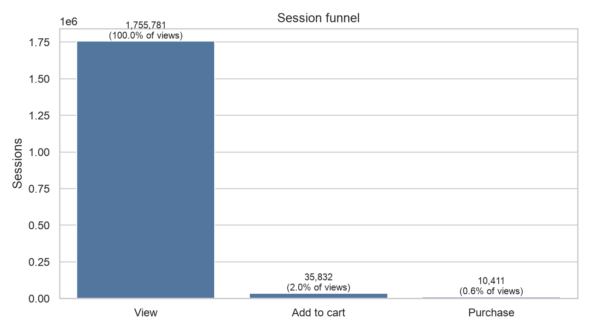
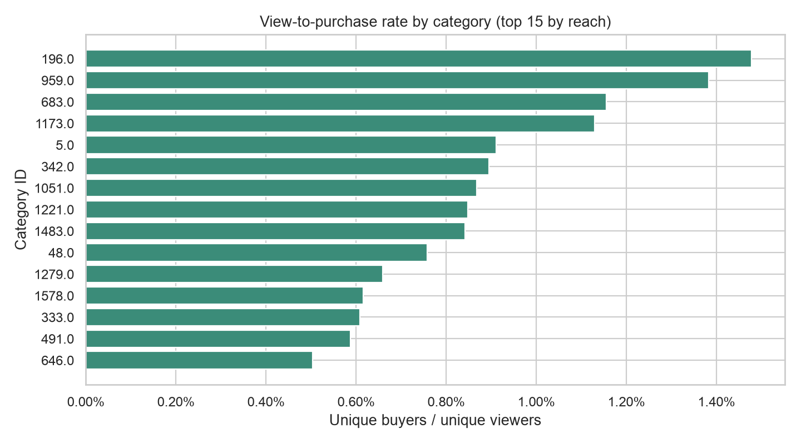
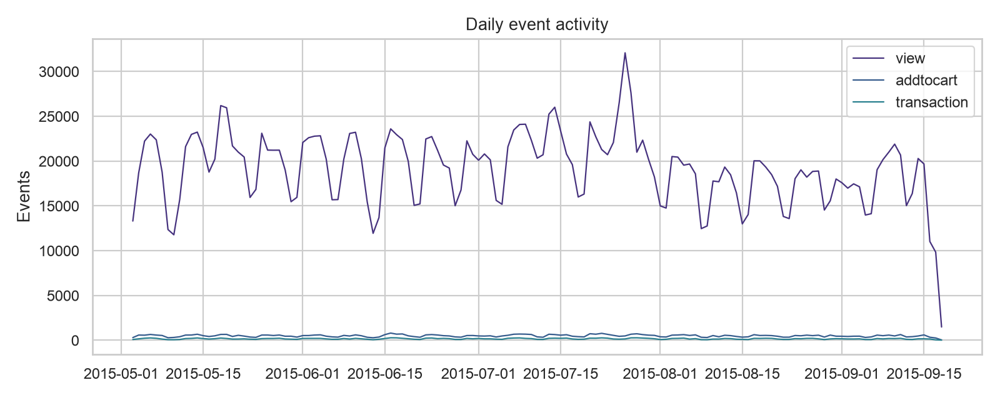

# Анализ поведения покупателей

В проекте проведены четыре анализа событий интернет-магазина: воронки покупок, различий между категориями товаров, повторных покупок и активности по дням. Для каждого анализа рассчитаны результаты и сохранены таблицы; для основных срезов построены графики.

## Результаты

- Обработано 2 756 101 событие от 1 407 580 посетителей.
- При разбиении событий на сессии с перерывом более 30 минут получено 1 755 781 сессия с просмотром.
- В 35 832 сессиях просмотр закончился последующим добавлением в корзину — 2,04% сессий с просмотром.
- В 10 411 сессиях после добавления в корзину произошла покупка — 29,1% сессий с добавлением. Конверсия из просмотра в покупку — 0,59%.
- Среди 11 719 посетителей с транзакциями 1 063 совершили покупки с двумя и более разными `transactionid` (9,1%).
- Проверка хи-квадрат показала различия в доле покупателей между категориями с не менее чем 100 уникальными посетителями, просмотревшими товар (χ² = 11 576,86; p < 0,001). Это статистическая связь; она не объясняет причину различий.

## Проведенные анализы

### Воронка по сессиям

Сессия засчитывается на следующем этапе, только если событие произошло после предыдущего в той же сессии. Число сессий и конверсии сохранены в `reports/funnel.csv`, график — в `reports/figures/funnel.png`.

### Конверсия по категориям

Для каждого товара использовано последнее найденное значение `categoryid`. По категориям рассчитаны уникальные посетители с просмотром, добавлением в корзину и покупкой. В таблицу включены категории с аудиторией не менее 100 посетителей. Итог проверки хи-квадрат находится в `reports/summary.json`, показатели категорий — в `reports/category_metrics.csv`, график — в `reports/figures/category_conversion.png`.

### Повторные покупки

Покупки считаются по уникальным `transactionid`. Число покупателей и доля посетителей с двумя и более транзакциями сохранены в `reports/repeat_purchase_metrics.csv`.

### Активность по дням

Посчитано число событий каждого типа по дням. Таблица находится в `reports/daily_activity.csv`, график — в `reports/figures/daily_activity.png`.

## Запуск анализа

### Данные

Скачайте CSV-файлы [Retailrocket E-commerce Dataset](https://www.kaggle.com/retailrocket/ecommerce-dataset) и положите их в `data/`. Исходные таблицы не добавлены в репозиторий: общий размер около 1 ГБ, а на Kaggle для набора указана лицензия CC BY-NC-SA 4.0. Подробнее — в [`data/README.md`](data/README.md).

### Установка и запуск

Из корневой папки проекта:

```bash
python -m venv .venv
source .venv/bin/activate
python -m pip install -r requirements.txt
python src/analyze.py
```

Команда `python -m pip` устанавливает зависимости в то же окружение Python, из которого запускается анализ.

## Графики







## Ограничения

В данных нет цены, выручки и назначения пользователей в экспериментальные группы. Сессии восстановлены по правилу 30 минут. Для повторных покупок транзакции определяются по `transactionid`. Категорийное сравнение показывает наблюдаемые различия, но не причинный эффект.
